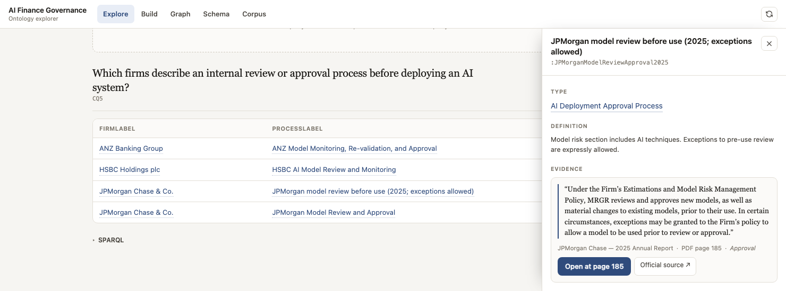
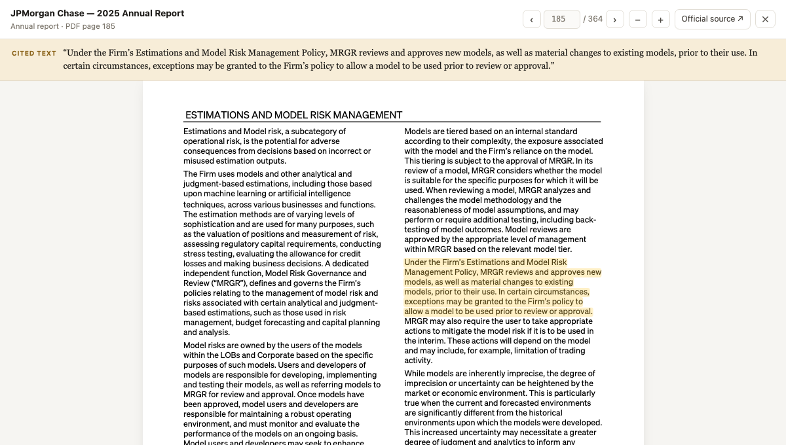
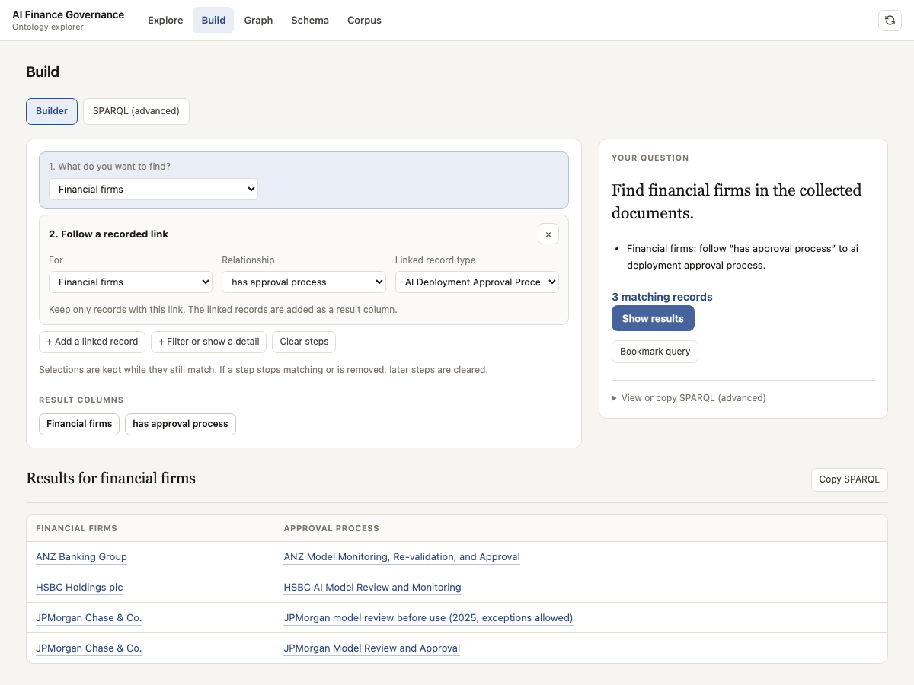
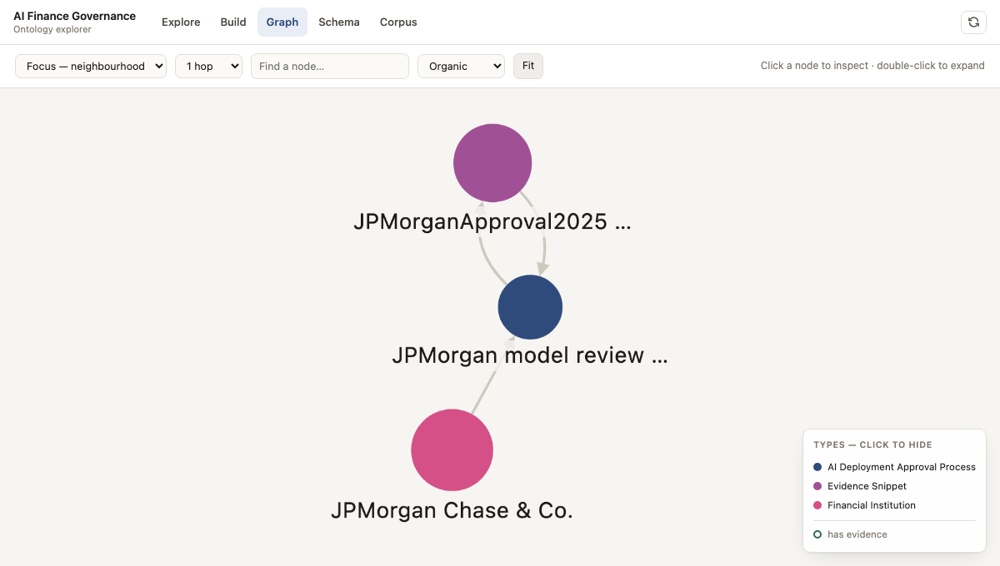

# AI Finance Governance Explorer

## Purpose

Banks and regulators can use different terms for similar practices, or use the same term with different meanings. That makes it hard to compare disclosures across institutions and jurisdictions. The project's **ontology** defines a shared vocabulary for institutions, frameworks and governance practices. Its **knowledge graph** applies that vocabulary to the collected documents and preserves the original wording, page or section reference, and links back to the source.

The prototype covers **7 financial institutions**, **32 archived source documents** and **94 evidence excerpts**. It includes CBA, NAB, Westpac, ANZ, JPMorgan Chase, Goldman Sachs and HSBC, alongside sources such as the EU AI Act, NIST AI Risk Management Framework and Australia's AI Ethics Principles.

## Source tracing

1. In **Explore**, run **CQ5**, which asks which firms describe a review or approval process before deploying an AI system.
2. In the results, open the 2025 **JPMorgan model review before use** record. The inspector shows the linked quotation and its citation.
3. Select **Open at page 185** to see the highlighted passage in the archived annual report.





## Explorer

- **Explore** runs the ten competency questions and supporting queries for tasks such as comparing terminology or finding gaps in the corpus. It also lists saved queries from Build.
- **Build** lets you assemble a question from record types, relationships and values present in the graph. It previews how many records match as you go. You can run, copy or bookmark the resulting SPARQL query, or write one in the advanced editor.
- **Graph** visualises the populated records, the class hierarchy or the immediate neighbours of a selected record. Select a node to inspect it, or open **See in graph** from a predefined query to highlight its returned resources.
- **Schema** shows the ontology's classes and properties, including their definitions and relationships.
- **Corpus** shows the archived sources and what was extracted from each. You can add a PDF or UTF-8 HTML file up to 25 MB, record quotations with source references, and link them to existing or new graph records. New evidence starts pending review.

Query Builder: start with **Financial firms**, follow **has approval process**, and select **AI Deployment Approval Process** as the linked record type. The builder generates SPARQL, a query language for linked data, from those selections.



The focused graph view shows how the JPMorgan approval record connects to the institution and the evidence excerpt.



## Run locally

Use Python 3.10 or later, a modern browser and a Bash-compatible shell.

```bash
git clone https://github.com/vmemphis1/48004381-Software-Prototype.git
cd 48004381-Software-Prototype
python3 -m venv .venv
source .venv/bin/activate
python3 -m pip install -r scripts/requirements.txt
explorer/run.sh
```

Open <http://127.0.0.1:8042/> if the browser doesn't open automatically. To use a different port, run `explorer/run.sh --port 8043`.

## Repository

| Component | Contents |
| --- | --- |
| [Ontology requirements](ontology/ORSD.md) | The research scope, modelling decisions and ten competency questions |
| [OWL/Turtle ontology](ontology/ai-finance-governance.ttl) | The vocabulary and populated graph, with [AIRO](ontology/airo.ttl) included locally for AI risk concepts and a mapping to FIBO's Financial Institution class |
| [Glossary](glossary/terms_v1.csv) | Selected terms, definitions, source references and ontology mappings |
| [Source corpus](corpus/) | Archived firm disclosures and regulatory or standards documents |
| [SPARQL query pack](queries/) | The ten competency queries and eleven supporting queries |
| [Explorer](explorer/) | A local Python server using RDFLib, with a JavaScript interface, Cytoscape graph visualisation and a PDF.js viewer |

### Reproduce the checks

The test suite uses Node.js 22.7 or later for browser-module tests. With the Python environment active, run:

```bash
python3 -m unittest discover -s explorer/tests -v
python3 scripts/audit_ontology.py
python3 scripts/run_queries.py
python3 scripts/verify_evidence_text.py
```

The scripts audit the graph structure and provenance, run the query pack against the bundled data, and verify each evidence quotation against its cited source.
